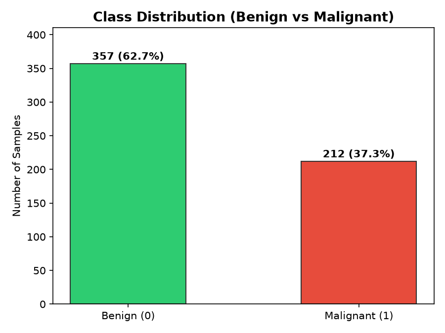
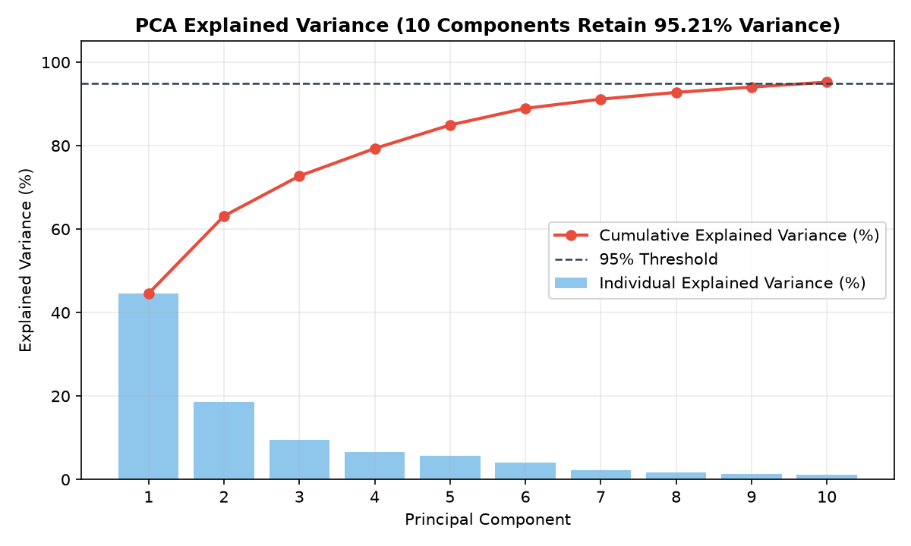
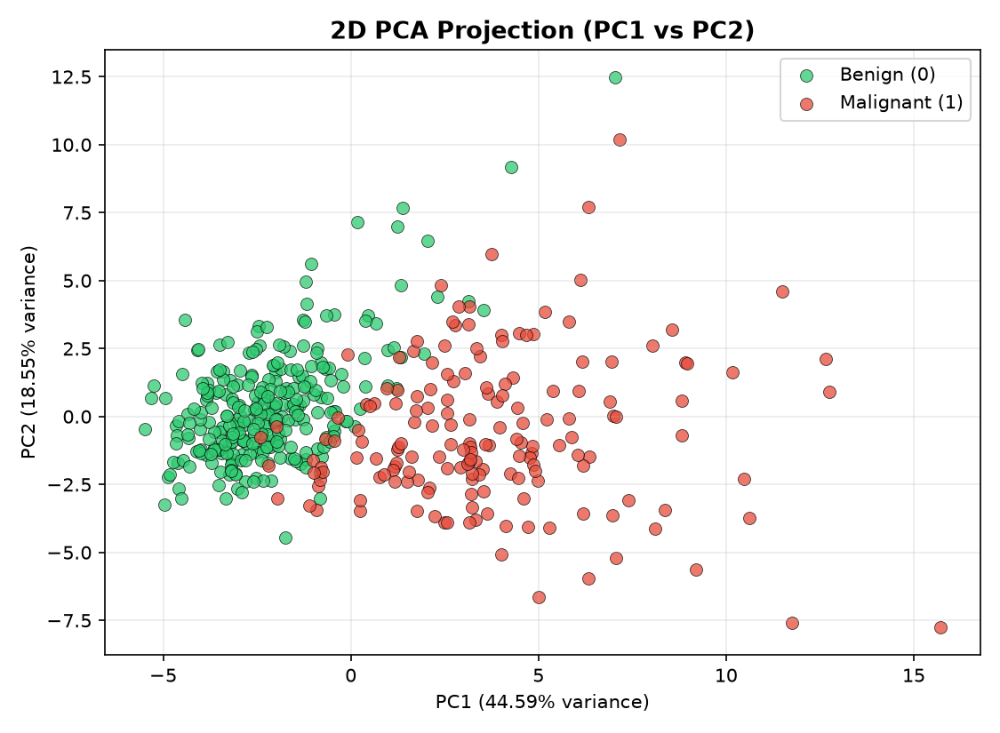
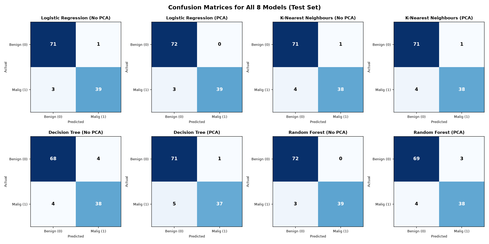
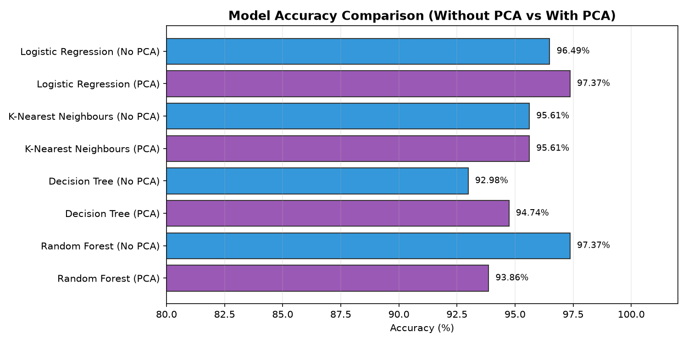
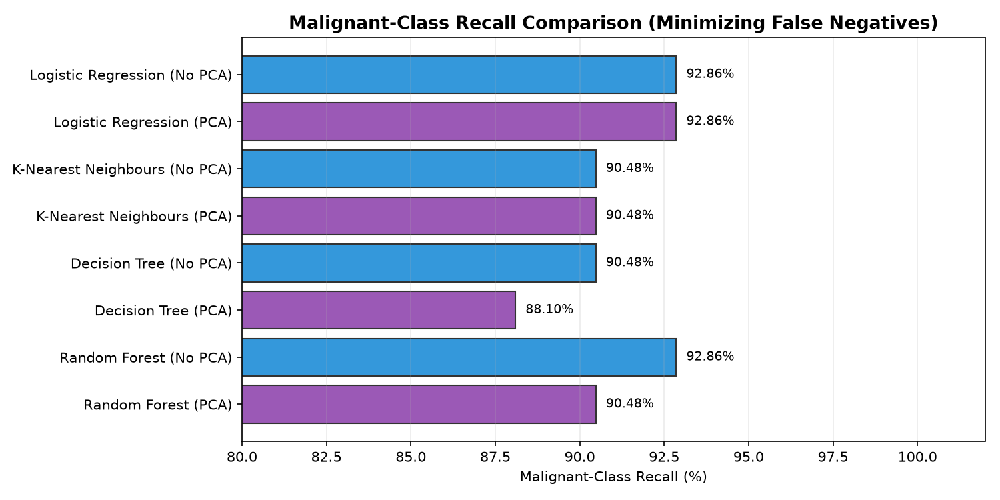

# TumorVision – Breast Cancer Classification Using PCA and Machine Learning

> **Educational Disclaimer:** This project and report are developed strictly for educational and academic purposes. It is not a medical diagnostic tool and must not be used to make medical decisions.

---

## 1. Project Title
**TumorVision – Breast Cancer Classification Using PCA and Machine Learning**

*(Student Name / Roll Number / Institution / Guide Name: `[Placeholder – Enter Your Details Here]`)*

---

## 2. Abstract
Early and accurate classification of breast tumours into **Benign** or **Malignant** categories is a classic and high-impact binary classification problem in machine learning. **TumorVision** presents a complete, leakage-free machine learning pipeline applied to a 569-sample breast cancer cell-nucleus dataset containing 30 numerical measurements. To examine the effect of dimensionality reduction on correlated medical measurements, **Principal Component Analysis (PCA)** is applied after standardization to retain at least 95% cumulative explained variance, reducing 30 features to **10 principal components** (95.21% variance retained). Four supervised algorithms—**Logistic Regression**, **K-Nearest Neighbours (KNN)**, **Decision Tree**, and **Random Forest**—are trained and evaluated both **without PCA** and **with PCA**, producing **8 trained models**. Experimental results on a stratified 20% test set (114 samples) demonstrate that **Logistic Regression (PCA)** and **Random Forest (No PCA)** achieve the highest performance with **97.37% accuracy**, **100.00% precision**, **92.86% malignant-class recall**, and **96.30% F1-score**. All models and preprocessing objects are serialized into `.pkl` files and integrated into an interactive **Streamlit** web application.

---

## 3. Introduction
Breast tumour classification datasets typically measure multiple geometric and textural properties of cell nuclei (such as radius, perimeter, area, smoothness, compactness, concavity, symmetry, and fractal dimension) across mean, standard error, and worst values. Because properties like radius, perimeter, and area are mathematically related, the feature space exhibits strong multicollinearity. Dimensionality reduction techniques such as **Principal Component Analysis (PCA)** can compress correlated features into orthogonal components, potentially improving generalization, reducing noise, and enabling 2D visualization.

**TumorVision** was built as an end-to-end educational system—combining exploratory data analysis, leakage-free Scikit-learn pipelines, PCA analysis, 8-model benchmarking, serialized model persistence, and a Streamlit web interface.

---

## 4. Problem Statement
Build an educational machine learning classification system that classifies breast tumour samples as **Malignant** or **Benign** using measured cell-nucleus features, and systematically study the effect of dimensionality reduction using **Principal Component Analysis (PCA)** across four different classification algorithms, with special emphasis on **Malignant-class recall** to minimize false negatives.

---

## 5. Objectives
1. Inspect and clean the provided breast cancer CSV dataset (handle missing/empty columns, identifier columns, duplicates, and data types).
2. Implement a leakage-free preprocessing pipeline with binary target encoding (`Malignant = 1`, `Benign = 0`), stratified 80:20 train-test splitting, and `StandardScaler` fit strictly on training data.
3. Apply PCA to determine the minimum number of components retaining $\ge 95\%$ cumulative explained variance, and visualize the 2D PCA projection (`PC1` vs `PC2`).
4. Train and evaluate 8 models (4 algorithms $\times$ 2 configurations: Without PCA vs. With PCA) using Scikit-learn `Pipeline`.
5. Compare all 8 models using Accuracy, Precision, Malignant Recall, F1-score, and Confusion Matrices.
6. Persist all trained models and preprocessing artifacts in `pickle/` and deploy an interactive Streamlit web application.

---

## 6. Dataset Description
- **Source File:** `dataset/breast_cancer.csv` (copied from the provided `breat cancer diagnosis.csv`)
- **Raw Dimensions:** 569 rows $\times$ 33 columns
- **Target Column:** `diagnosis` (`B` = Benign: 357 samples / 62.74%, `M` = Malignant: 212 samples / 37.26%)
- **Removed Unnecessary Columns:**
  - `Unnamed: 32`: 569/569 missing values (empty trailing-comma column)
  - `id`: Unique sample identifier (non-predictive)
- **Cleaned Feature Set:** 30 continuous `float64` cell-nucleus measurements (`radius_mean` through `fractal_dimension_worst`), with **0 missing values** and **0 duplicate rows**.

---

## 7. Technologies Used
- **Programming Language:** Python 3.14
- **Data Manipulation:** `pandas`, `numpy`
- **Machine Learning & Preprocessing:** `scikit-learn` (`StandardScaler`, `PCA`, `Pipeline`, `LogisticRegression`, `KNeighborsClassifier`, `DecisionTreeClassifier`, `RandomForestClassifier`)
- **Visualization:** `matplotlib`
- **Model Serialization:** `pickle`
- **Web Application:** `streamlit`
- **Notebook Environment:** Jupyter Notebook (`nbformat`, `nbconvert`, `ipykernel`)

---

## 8. Methodology
1. **Dataset Inspection & Cleaning:** Dynamically detect the binary target column (`diagnosis`), remove `Unnamed: 32` and `id`, verify zero duplicates and zero missing feature values.
2. **Train-Test Split:** Stratified 80:20 split (`455` training samples, `114` test samples) with `random_state=42`.
3. **Pipeline Architecture:** Each model is wrapped in a Scikit-learn `Pipeline` (`StandardScaler` $\rightarrow$ optional `PCA(n_components=0.95)` $\rightarrow$ Classifier) so scaling and PCA parameters are learned strictly from training data.
4. **Evaluation:** All 8 pipelines are evaluated on the held-out 114-sample test set (72 Benign, 42 Malignant).

---

## 9. Data Preprocessing
- **Target Mapping:** `B` $\rightarrow$ `0` (Benign, negative class), `M` $\rightarrow$ `1` (Malignant, positive class). Treating Malignant as `1` ensures Precision, Recall, and F1-score directly measure malignant detection performance, where False Negatives (classifying a malignant tumour as benign) are the most critical error.
- **Feature Scaling:** `StandardScaler` standardizes every feature to zero mean and unit variance ($\mu = 0, \sigma = 1$). This is essential for PCA, Logistic Regression, and distance-based KNN.

---

## 10. PCA Implementation
PCA was fit on the scaled training set (`455` samples $\times$ `30` features) with `n_components=0.95`:
- **Components Selected:** **10 Principal Components** (retaining **95.21%** cumulative explained variance).
- **Per-Component Explained Variance:**
  - `PC1`: 44.59% (Cumulative: 44.59%)
  - `PC2`: 18.55% (Cumulative: 63.14%)
  - `PC3`: 9.58% (Cumulative: 72.72%)
  - `PC4`: 6.59% (Cumulative: 79.32%)
  - `PC5`: 5.62% (Cumulative: 84.94%)
  - `PC6`: 3.99% (Cumulative: 88.93%)
  - `PC7`: 2.21% (Cumulative: 91.14%)
  - `PC8`: 1.61% (Cumulative: 92.76%)
  - `PC9`: 1.28% (Cumulative: 94.04%)
  - `PC10`: 1.17% (Cumulative: 95.21%)

**Information Loss:** Discarding the remaining ~4.79% variance removes minor fluctuations and potential noise, while reducing dimensionality by 66.7% (from 30 to 10 dimensions). However, principal components are linear combinations of original features, reducing direct feature-level interpretability.

---

## 11. Machine Learning Algorithms
1. **Logistic Regression** (`max_iter=1000`, `random_state=42`): Linear model estimating class probabilities via the sigmoid function.
2. **K-Nearest Neighbours (KNN)** (`n_neighbors=5`): Non-parametric distance-based classifier using the 5 nearest neighbours in scaled/PCA space.
3. **Decision Tree** (`random_state=42`): Rule-based tree splitting features by impurity reduction.
4. **Random Forest** (`n_estimators=100`, `random_state=42`): Ensemble of 100 decision trees using bagging and random feature subsets.

---

## 12. Experimental Results
- **Best Performing Models:** **Logistic Regression (PCA)** and **Random Forest (No PCA)** tied for the highest performance across all metrics on the test set:
  - **Accuracy:** 97.37% (111/114 correct)
  - **Precision:** 100.00% (0 False Positives)
  - **Malignant Recall:** 92.86% (39/42 malignant cases detected; 3 False Negatives)
  - **F1-Score:** 96.30%
- **Why Logistic Regression (PCA) Performed Better:** Removing multicollinearity among the 30 correlated features via 10 orthogonal principal components prevented coefficient instability and eliminated the 1 false positive seen in Logistic Regression without PCA (raising accuracy from 96.49% to 97.37% and precision from 97.50% to 100.00%).
- **Why Random Forest Performed Better Without PCA:** Tree ensembles split along individual original features and naturally handle correlated features; projecting onto rotated PCA axes reduced Random Forest accuracy from 97.37% to 93.86%.

---

## 13. Model Comparison Table

| Model | PCA Used | Accuracy | Precision | Malignant Recall | F1-Score | False Negatives (FN) | False Positives (FP) |
| :--- | :---: | :---: | :---: | :---: | :---: | :---: | :---: |
| **Logistic Regression (No PCA)** | No | 96.49% | 97.50% | 92.86% | 95.12% | 3 | 1 |
| **Logistic Regression (PCA)** | Yes | **97.37%** | **100.00%** | **92.86%** | **96.30%** | **3** | **0** |
| **K-Nearest Neighbours (No PCA)** | No | 95.61% | 97.44% | 90.48% | 93.83% | 4 | 1 |
| **K-Nearest Neighbours (PCA)** | Yes | 95.61% | 97.44% | 90.48% | 93.83% | 4 | 1 |
| **Decision Tree (No PCA)** | No | 92.98% | 90.48% | 90.48% | 90.48% | 4 | 4 |
| **Decision Tree (PCA)** | Yes | 94.74% | 97.37% | 88.10% | 92.50% | 5 | 1 |
| **Random Forest (No PCA)** | No | **97.37%** | **100.00%** | **92.86%** | **96.30%** | **3** | **0** |
| **Random Forest (PCA)** | Yes | 93.86% | 92.68% | 90.48% | 91.57% | 4 | 3 |

---

## 14. Graphs and Confusion Matrices
All generated figures are saved in `report/figures/`:
- **Class Distribution:** 
- **PCA Cumulative Explained Variance:** 
- **2D PCA Scatter Plot (PC1 vs PC2):** 
- **Confusion Matrices (All 8 Models):** 
- **Accuracy Comparison:** 
- **Malignant-Class Recall Comparison:** 

---

## 15. Limitations
1. **Small Single-Center Dataset:** 569 samples may not generalize to diverse populations or different imaging/measurement protocols.
2. **Educational Purpose Only:** Not clinically validated or approved for medical diagnosis.
3. **Feature Extraction Dependency:** Requires all 30 cell-nucleus features measured in the exact same scale and definitions.
4. **PCA Interpretability Trade-off:** Principal components obscure which specific physical measurement drove a prediction.

---

## 16. Future Scope
- Hyperparameter tuning using `GridSearchCV` / `StratifiedKFold` cross-validation.
- Threshold tuning or class-weighting (`class_weight='balanced'`) to further boost Malignant-class recall.
- Explainability integration using SHAP or LIME for non-PCA models.
- `[Placeholder – Add any additional institutional/academic future enhancements]`

---

## 17. Conclusion
**TumorVision** successfully demonstrates how PCA and supervised machine learning work together on breast tumour cell-nucleus data. PCA compressed 30 features into 10 components while preserving 95.21% of variance, improving linear and single-tree models (**Logistic Regression (PCA)** reached **97.37% accuracy** and **92.86% malignant recall**), while **Random Forest (No PCA)** matched that top performance using the original scaled features. All 8 models are saved and ready for interactive exploration in the Streamlit web app.
